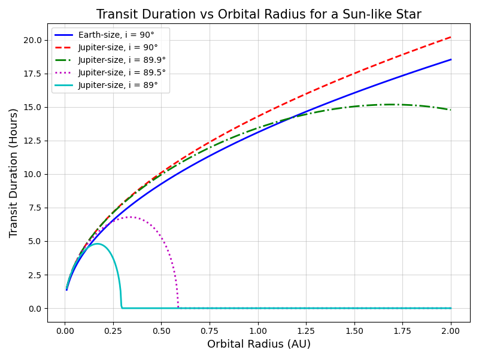

# Exoplanet Transit Durations for Different Orbital Inclinations

## Overview

This project investigates how the transit duration of an exoplanet varies with its orbital separation and orbital inclination around a Sun-like star.

The analysis considers two planetary sizes: an Earth-size planet and a Jupiter-size planet. The effect of changing orbital inclination on transit duration is examined for the Jupiter-size planet.

Python is used to calculate orbital periods, estimate transit durations, and visualise the results.

## Objectives

- Calculate the transit duration of an Earth-size planet orbiting a Sun-like star at an inclination of 90°.
- Investigate the transit duration of a Jupiter-size planet at different orbital inclinations: 90°, 89.9°, 89.5°, and 89°.
- Study how transit duration changes with orbital separation.
- Compare the effect of planetary radius and orbital inclination on transit duration.

## Theoretical Background

The orbital period is calculated using Kepler's Third Law:

**P = 2π√(a³ / GM_Sun)**

where:
- P is the orbital period.
- a is the orbital separation.
- G is the gravitational constant.
- M☉ is the mass of the Sun.

The transit duration is calculated using:

**T = (P/π) sin⁻¹[(R_Sun/a) √((1 + Rp/R_Sun)² − (a cos i/R_Sun)²) / sin i]**

where:
- T is the transit duration.
- R_Sun is the radius of the Sun.
- Rp is the radius of the planet.
- i is the orbital inclination.
- a is the orbital separation.

The orbital period is calculated in days, and the resulting transit duration is converted into hours.

## Methodology

The analysis involves:

1. Defining the physical constants for the Sun, Earth, Jupiter, and the astronomical unit.
2. Generating an orbital separation range from 0.01 AU to 2 AU.
3. Calculating the orbital period using Kepler's Third Law.
4. Computing transit durations for an Earth-size planet at 90° inclination.
5. Repeating the calculations for a Jupiter-size planet at four different inclinations.
6. Plotting all configurations together to compare their transit durations.

## Scenarios Investigated

| Planetary size | Orbital inclination |
|---|---|
| Earth-size | 90° |
| Jupiter-size | 90° |
| Jupiter-size | 89.9° |
| Jupiter-size | 89.5° |
| Jupiter-size | 89° |


## Results and Visualisation

The plot below shows the variation of transit duration with orbital separation for an Earth-size planet and a Jupiter-size planet at different orbital inclinations.



**Figure 1:** Transit duration versus orbital separation for the five configurations considered.

## Conclusion

This homework demonstrates how the duration of an exoplanet transit depends on orbital separation, planetary radius, and orbital inclination.

By comparing the Earth-size and Jupiter-size planets, the effect of planetary radius on transit duration can be examined. The different Jupiter-size configurations also illustrate how small changes in orbital inclination affect the transit duration.

The exercise provided practical experience in applying Kepler's Third Law, calculating transit durations, and using Python for computational modelling and scientific visualisation.

## Repository Structure

```text
exoplanet-transit-duration/
├── transit_duration.py
├── README.md
└── requirements.txt
```

## Requirements

The project uses the following Python libraries:

- NumPy
- Matplotlib

Install the dependencies using:

```bash
pip install -r requirements.txt
```

## Execution

Run the Python script using:

```bash
python transit_duration.py
```

## Tools and Technologies

- Python
- NumPy
- Matplotlib

## Acknowledgement

This project was completed as part of academic coursework in Astronomy and Astrophysics.